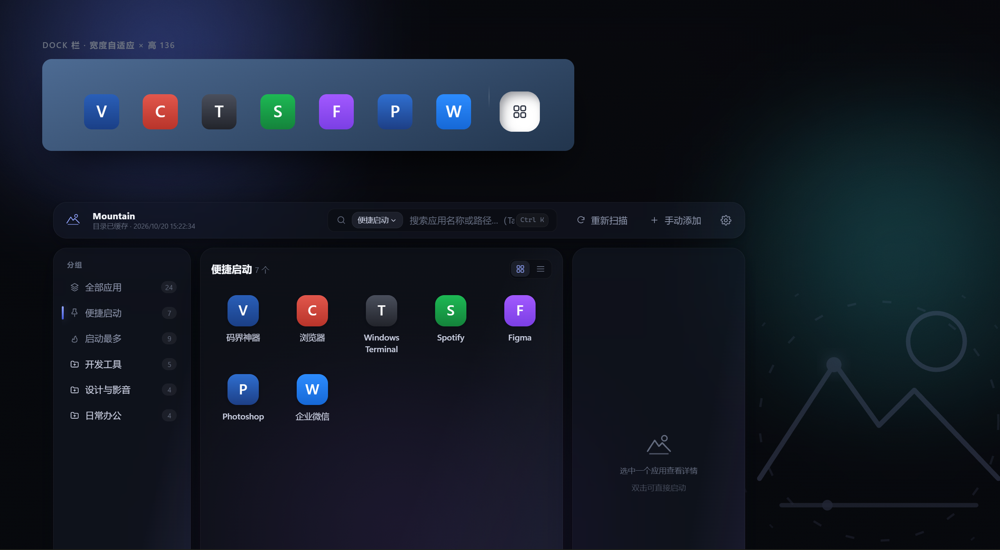

# Tauri + React + Typescript

This template should help get you started developing with Tauri, React and Typescript in Vite.

## Recommended IDE Setup

- [VS Code](https://code.visualstudio.com/) + [Tauri](https://marketplace.visualstudio.com/items?itemName=tauri-apps.tauri-vscode) + [rust-analyzer](https://marketplace.visualstudio.com/items?itemName=rust-lang.rust-analyzer)

## 代码签名

Windows 安装包由 [SignPath Foundation](https://signpath.org) 提供的开源项目免费代码签名服务签名（发布者：SignPath Foundation），以消除 SmartScreen 安装警告。详见 [代码签名政策](./CODE-SIGNING-POLICY.md)。
